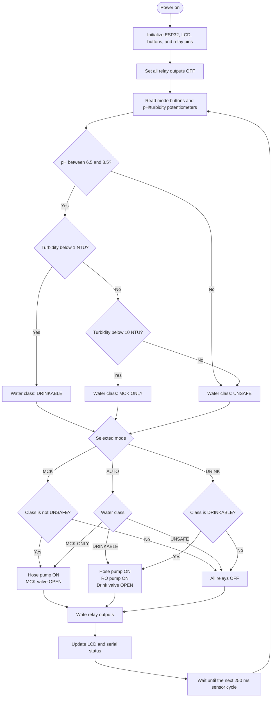
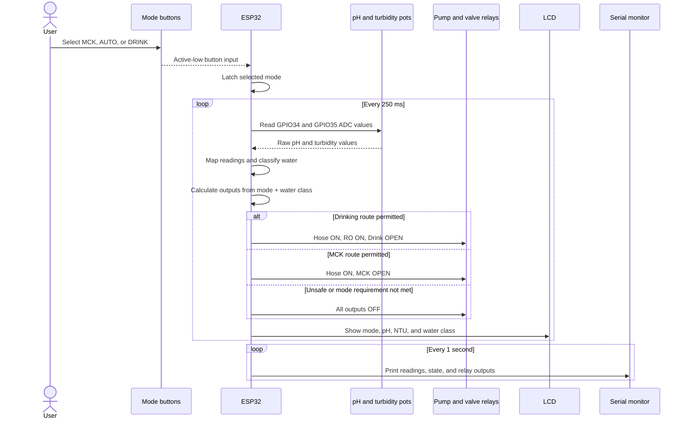

# O.A.S.I.S. control simulation

This PlatformIO/Wokwi milestone simulates the pH and turbidity sensors with two potentiometers. TDS is intentionally excluded.

## Controls

- pH potentiometer (GPIO34): maps 0-4095 to pH 0.0-14.0.
- Turbidity potentiometer (GPIO35): maps 0-4095 to 0-50 NTU.
- `1` / blue button: MCK mode.
- `2` / yellow button: AUTO mode.
- `3` / green button: DRINK mode.

The 20x4 I2C LCD displays the selected mode, pH, turbidity, and the resulting water class.

## Current quality rules

| Water class | Simulated criteria |
| --- | --- |
| Drinkable | pH 6.5-8.5 and turbidity below 1 NTU |
| MCK only | pH 6.5-8.5 and turbidity below 10 NTU |
| Unsafe | Any other reading |

These potentiometer conversions are simulation mappings, not calibration equations for physical sensors.

## Control flowchart

## Runtime sequence

## Relay behavior

| Mode | Drinkable | MCK only | Unsafe |
| --- | --- | --- | --- |
| MCK | Hose pump + MCK valve | Hose pump + MCK valve | All off |
| AUTO | Hose pump + RO pump + drink valve | Hose pump + MCK valve | All off |
| DRINK | Hose pump + RO pump + drink valve | All off | All off |

The Wokwi relay modules use the `pnp` setting, so the firmware drives their IN pins HIGH to connect COM to NO. The LEDs connected to NO indicate active outputs.

## Build and simulate

Run `pio run` in this directory. Then start the Wokwi simulator from VS Code; `wokwi.toml` points to the generated ESP32 firmware and ELF files.
