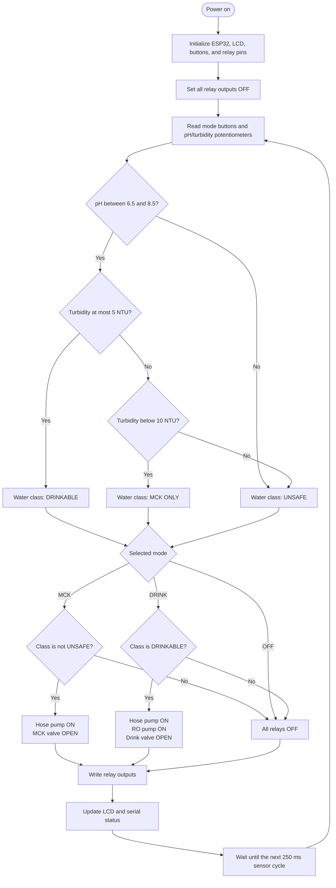
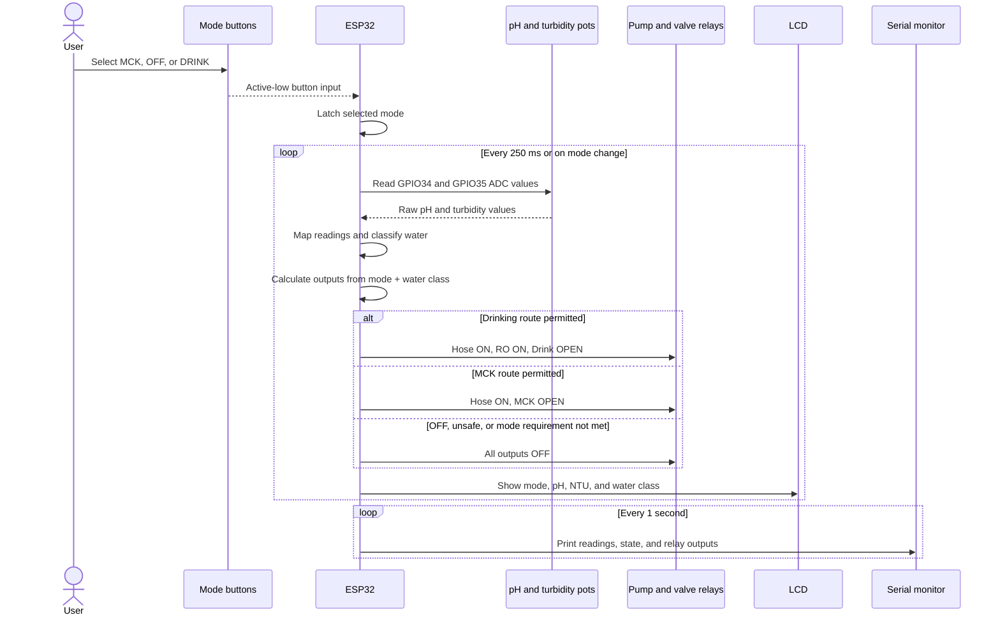

# O.A.S.I.S. control simulation

This PlatformIO/Wokwi milestone simulates the pH and turbidity sensors with two potentiometers. TDS is intentionally excluded.

For the project overview, group member names/NPM, setup instructions, and demo walkthrough, see the [repository README](../README.md).

## Hardware and pin mapping

Target: ESP32 Dev Module (`esp32dev`), Arduino framework, Espressif32 platform. The LCD uses `marcoschwartz/LiquidCrystal_I2C @ ^1.1.4` at I2C address `0x27`.

| Component | ESP32 GPIO | Configuration |
| --- | --- | --- |
| pH potentiometer | 34 | 12-bit ADC, mapped to 0–14 pH |
| Turbidity potentiometer | 35 | 12-bit ADC, mapped to 0–50 NTU |
| MCK button | 13 | Active-low, INPUT_PULLUP |
| OFF button | 14 | Active-low, INPUT_PULLUP |
| DRINK button | 27 | Active-low, INPUT_PULLUP |
| LCD SDA / SCL | 21 / 22 | I2C, 20 columns × 4 rows |
| Hose pump relay | 18 | Active-low PNP module |
| MCK valve relay | 19 | Active-low PNP module |
| RO pump relay | 23 | Active-low PNP module |
| Drink valve relay | 5 | Active-low PNP module |

Sensor conversions: `pH = raw * 14 / 4095`, `NTU = raw * 50 / 4095`. Wokwi's knob attribute uses its own scale; use the resulting LCD values during a demo. The LCD rounds to two decimals; classification uses the unrounded values.

## Controls

- pH potentiometer (GPIO34): maps 0-4095 to pH 0.0-14.0.
- Turbidity potentiometer (GPIO35): maps 0-4095 to 0-50 NTU.
- `1` / blue button: MCK mode.
- `2` / yellow button: OFF mode (all outputs disabled).
- `3` / green button: DRINK mode.

The 20x4 I2C LCD displays the selected mode, pH, turbidity, and the resulting water class.

Startup mode is OFF. Click a button once to select and retain a mode; releasing it does not reset the mode. Selecting MCK or DRINK starts the permitted route without a separate start button. OFF keeps the ESP32, sensors, and LCD running but disables all pumps and valves. OFF has immediate priority. The diagram disables button bounce, so firmware accepts short clicks without a debounce delay; physical contacts require an appropriate debounce interval. Simultaneous MCK and DRINK requests select OFF. Release the buttons before selecting again. Do not Ctrl-click to hold these mode buttons.

These momentary buttons emulate mutually exclusive selector choices in firmware. They do not emulate the electrical contacts of a maintained three-position selector. The physical selector will need position-reading logic matched to its actual contact arrangement. Wokwi's standard slide switch has only two positions.

## Current quality rules

| Water class | Simulated criteria |
| --- | --- |
| Drinkable | pH 6.5-8.5 and turbidity at most 5 NTU |
| MCK only | pH 6.5-8.5 and turbidity above 5 but below 10 NTU |
| Unsafe | Any other reading |

These potentiometer conversions are simulation mappings, not calibration equations for physical sensors.

The team's preferred drinking-route turbidity target is below 0.3 NTU. The acceptance cutoff in this simulation is inclusive at 5 NTU; the preferred target does not separately gate the relays. These are team-defined simulation criteria, not a certification of drinking-water safety.

The simulation does not model filtration or RO treatment: switching pumps or modes does not change the sensor readings. It routes water based on the current readings only. There are no separate inlet/outlet sensors, treatment delay, or post-treatment verification. MCK ONLY applies above 5 and below 10 NTU with pH in range; exactly 10 NTU is UNSAFE.

## Control flowchart

## Runtime sequence

## Relay behavior

| Mode | Drinkable | MCK only | Unsafe |
| --- | --- | --- | --- |
| MCK | Hose pump + MCK valve | Hose pump + MCK valve | All off |
| OFF | All off | All off | All off |
| DRINK | Hose pump + RO pump + drink valve | All off | All off |

The Wokwi relay modules use the `pnp` setting. Simulation verification showed active-low behavior: firmware drives IN LOW to activate the load and HIGH to disable it. The LEDs connected to NO indicate active outputs.

## Build and simulate

Run `pio run` in this directory. Then start the Wokwi simulator from VS Code; `wokwi.toml` points to the generated ESP32 firmware and ELF files.
